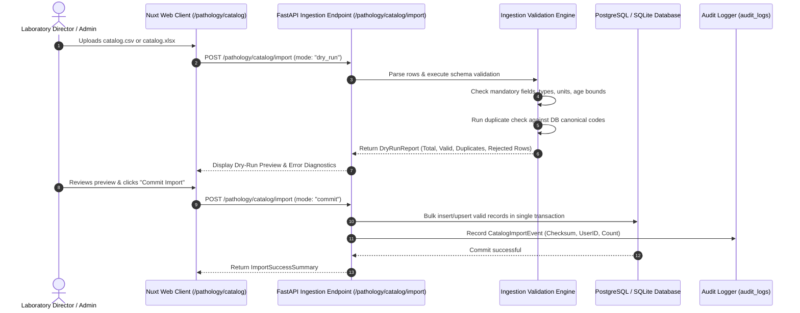

# Catalog Import and Validation Pipeline - Aarozi Healthcare

**Author**: Clinical Data Quality Engineer & Backend Architect  
**Scope**: Specifications and design for an idempotent, robust CSV/XLSX pipeline for importing 1,000+ master tests, reference intervals, profiles, and packages.

---

## 1. Import Pipeline Architecture & Execution Flow



---

## 2. Pydantic Ingestion Schemas & Row Constraints

Incoming records must validate against strictly typed Pydantic models before hitting the database:

```python
from pydantic import BaseModel, Field, field_validator
from typing import Literal

class MasterTestImportRow(BaseModel):
    test_code: str = Field(..., min_length=2, max_length=64, description="Unique test code")
    test_name: str = Field(..., min_length=2, max_length=255, description="Clinical test name")
    category: str = Field(..., max_length=100)
    sub_category: str | None = None
    specimen_type: str = Field(..., max_length=100)
    container_type: str = Field(..., max_length=100)
    methodology: str | None = None
    unit_of_measurement: str | None = None
    result_type: Literal["numeric", "qualitative", "text", "calculated"] = "numeric"
    decimal_precision: int = Field(default=2, ge=0, le=4)
    
    # Reference Range Fields
    age_min_days: int = Field(default=0, ge=0)
    age_max_days: int = Field(default=43800, le=43800)
    sex: Literal["all", "male", "female"] = "all"
    low_value: float | None = None
    high_value: float | None = None
    critical_low: float | None = None
    critical_high: float | None = None
    text_range: str | None = None
    source_citation: str | None = None

    @field_validator("high_value")
    @classmethod
    def validate_range_bounds(cls, high, info):
        low = info.data.get("low_value")
        if low is not None and high is not None and high < low:
            raise ValueError(f"high_value ({high}) cannot be lower than low_value ({low})")
        return high

    @field_validator("critical_low")
    @classmethod
    def validate_critical_low(cls, crit_low, info):
        low = info.data.get("low_value")
        if crit_low is not None and low is not None and crit_low > low:
            raise ValueError(f"critical_low ({crit_low}) cannot be greater than normal low_value ({low})")
        return crit_low
```

---

## 3. Duplicate Detection & Code Normalization

1. **Exact Code Collision**:
   - If an imported `test_code` exactly matches an existing record in `tests`:
     - In Master Catalog mode: Update metadata if version matches, or reject if conflicting data types.
     - In Tenant Mode: Create a tenant-specific override in `test_reference_ranges` and `price_list_items` without altering the master definition.
2. **Clinical Name & Synonym Collision**:
   - In addition to canonical codes, the validator checks normalized test names (lowercased, stripped of punctuation) using Levenshtein distance:
     - Distance `< 2` (e.g., `Blood Glucose Fasting` vs `Blood Glucose (Fasting)`): Flagged with warning code `POSSIBLE_DUPLICATE` to prevent accidental duplicate catalog entries.
3. **Unit Normalization**:
   - Common unit variants are normalized to standard SI notation while preserving the original string:
     - `mg/dl` -> `mg/dL`
     - `g/dl` -> `g/dL`
     - `ug/dl`, `mcg/dl` -> `µg/dL`
     - `iu/l`, `u/l` -> `U/L`

---

## 4. Rejection Diagnostics & Dry-Run Preview Report

Every row processed during ingestion is assigned a classification:
- `ACCEPTED`: Row is completely valid and ready for commit.
- `WARNING`: Row will be imported but has minor notes (e.g., missing clinical methodology, missing reference range marked as unverified).
- `REJECTED`: Row violates structural constraints or clinical invariants.

### Rejection Reason Codes
- `ERR_EMPTY_CODE`: Test code or name is missing.
- `ERR_INVALID_RESULT_TYPE`: Result type is not one of numeric, qualitative, text, calculated.
- `ERR_RANGE_INVERTED`: `high_value` is less than `low_value`.
- `ERR_CRITICAL_BOUNDS`: `critical_high` is lower than normal `high_value`.
- `ERR_INVALID_AGE_BOUNDS`: `age_min_days` is greater than `age_max_days`.
- `ERR_UNIT_MISMATCH`: Numeric test provided without unit of measurement.

### Dry-Run Output Contract
```json
{
  "summary": {
    "total_rows_scanned": 1050,
    "accepted_count": 1028,
    "warning_count": 14,
    "rejected_count": 8,
    "checksum_sha256": "e3b0c44298fc1c149afbf4c8996fb92427ae41e4649b934ca495991b7852b855"
  },
  "rejections": [
    {
      "row_number": 42,
      "test_code": "SER_POT",
      "test_name": "Serum Potassium",
      "error_code": "ERR_RANGE_INVERTED",
      "error_detail": "high_value (3.5) cannot be lower than low_value (5.1)"
    }
  ]
}
```
