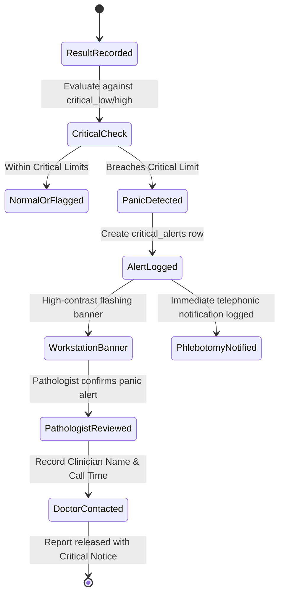

# Reference Range, Observation & Comment Engine - Aarozi Healthcare

**Author**: Clinical Data Quality Engineer & LIS Domain Expert  
**Scope**: Algorithmic rules for reference range evaluation, result flagging, delta checks, observation suggestions, and critical panic value escalations.

---

## 1. Architectural Separation of Clinical Concepts

To safeguard patient health and prevent diagnostic errors, the system enforces a strict distinction between five related clinical concepts:

```
[ Measured Result Value ]
           │
           ▼
1. Biological Reference Range (Laboratory-defined comparison interval based on age, sex, method)
           │
           ▼
2. Machine-Readable Result Flag ('L' = Low, 'H' = High, 'LL' = Critical Low, 'HH' = Critical High, 'N' = Normal)
           │
           ▼
3. Interpretive Comment (Approved explanatory content describing physiological significance)
           │
           ▼
4. Clinical Recommendation (Evidence-based advisory requiring responsible pathologist authorization)
           │
           ▼
5. Critical Alert Escalation (Urgent workflow: immediate SMS/phone call/system notification for life-threatening values)
```

---

## 2. Evaluation Logic & Mathematical Boundary Rules

### A. Numeric Range Evaluation
For a patient of age $A$ (in days) and sex $S$, matching a reference interval with $[\text{low}, \text{high}]$ and critical limits $[\text{crit\_low}, \text{crit\_high}]$:

- If $\text{crit\_low} \neq \text{null}$ and $\text{value} \le \text{crit\_low} \implies \mathbf{LL}$ (Critical Low Panic)
- Else if $\text{crit\_high} \neq \text{null}$ and $\text{value} \ge \text{crit\_high} \implies \mathbf{HH}$ (Critical High Panic)
- Else if $\text{low} \neq \text{null}$ and $\text{value} < \text{low} \implies \mathbf{L}$ (Low)
- Else if $\text{high} \neq \text{null}$ and $\text{value} > \text{high} \implies \mathbf{H}$ (High)
- Else $\implies \mathbf{N}$ (Normal)

### B. Qualitative & Categorical Evaluation
For serology, microbiology, and urinalysis investigations (e.g., Dengue NS1, HIV, Urine Ketones):
- `Negative`, `Non-Reactive`, `Nil`, `Absent` $\implies \mathbf{N}$ (Normal)
- `Positive`, `Reactive`, `Present`, `Detected` $\implies \mathbf{A}$ (Abnormal / Reactive)
- `Equivocal`, `Borderline` $\implies \mathbf{W}$ (Warning / Retest recommended)

### C. Calculated & Derived Parameters
Formulas are executed deterministically using sandboxed evaluation:
- **eGFR (CKD-EPI 2021)**: Derived from Serum Creatinine, Age, and Sex.
- **VLDL Cholesterol**: $\text{Triglycerides} / 5$ (valid when $\text{Triglycerides} < 400 \text{ mg/dL}$).
- **Globulin**: $\text{Total Protein} - \text{Albumin}$.
- **A/G Ratio**: $\text{Albumin} / \text{Globulin}$.

---

## 3. Clinical Safety Guards & Diagnostic Boundaries

1. **Never Infer Definitive Medical Diagnosis**:
   - The engine NEVER outputs statements such as *"Patient has Diabetes"* or *"Patient has Hepatitis"*.
   - Output comments MUST use objective clinical observation phrasing:
     - *Valid*: *"Fasting plasma glucose $\ge 126 \text{ mg/dL}$ is consistent with criteria for hyperglycemia on a single reading; repeat testing on an alternate day is recommended for clinical confirmation."*
     - *Forbidden*: *"Patient is diabetic. Start metformin immediately."*
2. **AI-Assisted Interpretation Safeguards**:
   - AI generation of clinical comments is strictly optional, advisory, and non-authoritative.
   - AI models can NEVER:
     - Automatically sign off or release a clinical report.
     - Modify, round, or overwrite any measured laboratory instrument result.
     - Invent or hallucinate a reference range interval.
   - Any AI-suggested interpretation draft must be explicitly inspected, verified, and stamped by the licensed pathologist's digital credentials.
3. **Delta Checks Against Prior Patient History**:
   - When a patient has a prior recorded result for the same test within 30 days:
     - Absolute Delta: $|\text{value}_{\text{current}} - \text{value}_{\text{prior}}|$
     - Percentage Delta: $\left| \frac{\text{value}_{\text{current}} - \text{value}_{\text{prior}}}{\text{value}_{\text{prior}}} \right| \times 100\%$
   - Significant shifts (e.g., Hemoglobin drop $> 3 \text{ g/dL}$ in 24 hours, or Creatinine rise $> 50\%$) trigger a `DELTA_FLAG` warning on the workstation to prompt re-checking for specimen misidentification or IV dilution.

---

## 4. Critical Alert Escalation Workflow


