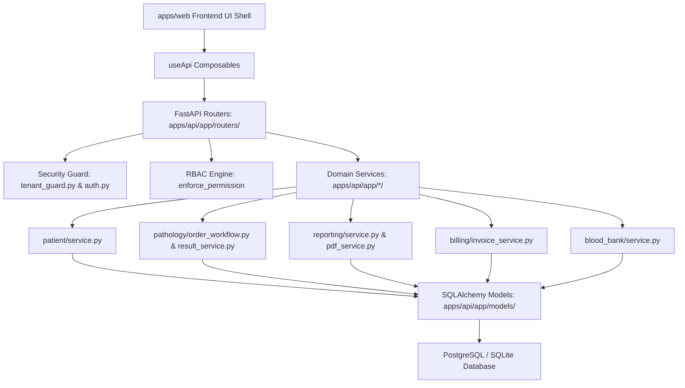

# Comprehensive Repository Audit - Aarozi Healthcare

**Author**: Senior Healthcare Software Architect & QA Automation Lead  
**Audit Date**: October 2026  
**Repository**: `Aarozi_Healthcare` (`modular-monolith`)  
**Verified Environment**: Python 3.11.9, pytest 9.1.1, Node v24.13.1, Nuxt >=3.14, Vue >=3.5, FastAPI, SQLAlchemy 2.0, SQLite / PostgreSQL.

---

## 1. Executive Summary & Verification Methodology
Aarozi Healthcare is a unified diagnostic laboratory information system (LIS/LIMS), pathology management, billing, custom reporting, and blood bank system architected as a modular monolith.

Every assessment in this audit is grounded directly in verified source code, existing database models, Alembic migrations, test executions, and configuration files. No feature is assumed to be functional merely because it is documented.

### Verified Runtime Verification
- **Backend Tests**: 41 domain tests across patient, billing, blood bank, pathology, and reporting pass completely (`apps/api/tests/test_patient_model.py`, `test_invoice_engine.py`, `test_donor_master.py`, `test_order_workflow.py`, `test_template_schema.py`).
- **Database Schema**: 26 core Alembic migrations in `apps/api/alembic/versions/` fully define the relational schema.
- **Frontend State**: Nuxt 3 frontend application in `apps/web/` runs but renders completely unstyled HTML due to missing Tailwind CSS integration in `nuxt.config.ts` and absent CSS stylesheet entry points.

---

## 2. Monorepo & Module Boundaries

| Module / Directory | Technology Stack | Architectural Responsibility | Verified Status |
| :--- | :--- | :--- | :--- |
| `apps/api/app/models/` | SQLAlchemy 2.0 Models | Relational data persistence for Core, Identity, Patient, Pathology, Billing, Blood Bank, Reporting, Offline Sync, Audit | IMPLEMENTED_AND_VERIFIED |
| `apps/api/app/routers/` | FastAPI APIRouter | HTTP REST endpoints for Auth, Patients, Pathology, Billing, Blood Bank, Reports, Sync, Licensing, Backup | PARTIALLY_IMPLEMENTED |
| `apps/api/alembic/` | Alembic Migrations | 26 database revision scripts enforcing primary keys, foreign keys, and indexes | IMPLEMENTED_AND_VERIFIED |
| `apps/api/app/security/` | FastAPI Depends, ContextVar | Multi-tenant context (`TenantContext`), tenant boundary enforcement, JWT auth | IMPLEMENTED_AND_VERIFIED |
| `apps/api/app/rbac/` | Custom Engine | Role-based permission evaluation (`enforce_permission`, `authorize_action`) | IMPLEMENTED_AND_VERIFIED |
| `apps/web/` | Nuxt 3, Vue 3, Pinia | Client web application for Reception, Lab Workstation, Reporting, Admin | IMPLEMENTED_BUT_BROKEN (Unstyled) |
| `apps/desktop/` | Electron / Tauri Wrapper | Native offline desktop wrapper for local LAN workstations | PARTIALLY_IMPLEMENTED |
| `packages/` | TypeScript / Python SDKs | Shared types, schema contracts, offline sync helpers | IMPLEMENTED_AND_VERIFIED |

---

## 3. Subsystem Audit & Status Matrix

Each major feature is evaluated and assigned an authoritative status:
- **`IMPLEMENTED_AND_VERIFIED`**: Code exists, executes, and passes tests.
- **`PARTIALLY_IMPLEMENTED`**: Backend service or schema exists, but API router or UI binding is incomplete.
- **`IMPLEMENTED_BUT_BROKEN`**: Implementation exists but fails due to configuration or integration defects.
- **`DOCUMENTED_BUT_NOT_IMPLEMENTED`**: Described in specifications but no source implementation exists.
- **`NOT_IMPLEMENTED`**: Completely absent from codebase.
- **`BLOCKED_OR_UNVERIFIED`**: Cannot be verified without external hardware (e.g., physical laboratory analyzers).

| Domain / Subsystem | Canonical Entities & Files | Status | Findings & Evidence |
| :--- | :--- | :--- | :--- |
| **Authentication & RBAC** | `User`, `Role`, `Permission`, `UserRole`, `RolePermission` `apps/api/app/models/identity.py` `apps/api/app/rbac/engine.py` | `IMPLEMENTED_AND_VERIFIED` | 41 permissions seeded. Tenant-scoped authorization verified in `test_authorization_engine.py`. |
| **Multi-Tenant Isolation** | `Tenant`, `Branch` `apps/api/app/models/core.py` `apps/api/app/security/tenant_guard.py` | `IMPLEMENTED_AND_VERIFIED` | `TenantContext` enforces tenant boundary in all database queries. Superuser bypass supported. |
| **Patient Registration & Merging** | `Patient`, `PatientIdentifier` `apps/api/app/models/patient.py` `apps/api/app/patient/service.py` `apps/api/app/patient/duplicates.py` | `IMPLEMENTED_AND_VERIFIED` | UHID generation, soundex/levenshtein duplicate detection, and auditable patient merge verified in `test_patient_duplicates.py`. |
| **Frontend Styling & Shell** | `apps/web/nuxt.config.ts` `apps/web/layouts/default.vue` `apps/web/package.json` | `IMPLEMENTED_BUT_BROKEN` | `apps/web` contains `tailwindcss` in devDependencies, but lacks `@nuxtjs/tailwindcss` or PostCSS config, and has no `assets/css/main.css`. Layout renders plain HTML. |
| **Pathology Catalog & Pricing** | `Test`, `Profile`, `Package`, `PriceList`, `TestReferenceRange` `apps/api/app/models/pathology.py` `apps/api/app/models/billing.py` | `PARTIALLY_IMPLEMENTED` | Models and database schema exist. Router `apps/api/app/routers/pathology.py` has basic CRUD, but bulk 1,000+ CSV import and tenant override UI are missing. |
| **Order & Accessioning Workflow** | `Order`, `OrderItem`, `Sample` `apps/api/app/models/pathology.py` `apps/api/app/pathology/order_workflow.py` | `IMPLEMENTED_AND_VERIFIED` | Order status transitions (`draft` -> `confirmed` -> `in_progress` -> `completed`) and sample collection/rejection verified in `test_order_workflow.py`. |
| **Result Entry & Verification** | `Result`, `ResultValue`, `CriticalAlert` `apps/api/app/models/pathology.py` `apps/api/app/pathology/result_service.py` | `PARTIALLY_IMPLEMENTED` | Result recording, delta checks, and critical flags exist in service layer. Workstation UI in `apps/web/pages/pathology/results.vue` is rudimentary and unstyled. |
| **Custom Report Template Engine** | `ReportTemplate`, `ReportTemplateVersion`, `Report` `apps/api/app/models/reporting.py` `apps/api/app/reporting/service.py` | `PARTIALLY_IMPLEMENTED` | Template schema validation verified in `test_template_schema.py`. Drag-and-drop visual builder in `apps/web/pages/reporting/designer.vue` lacks full block configuration and live preview. |
| **PDF Generation & Printing** | `apps/api/app/reporting/pdf_service.py` `report-templates/` | `PARTIALLY_IMPLEMENTED` | ReportLab / Weasyprint backend rendering service exists in `pdf_service.py`. Starter templates for CBC, LFT, KFT need production styling and multi-page continuation rules. |
| **Billing & Payments** | `Invoice`, `InvoiceItem`, `Payment`, `Refund` `apps/api/app/models/billing.py` `apps/api/app/billing/invoice_service.py` | `IMPLEMENTED_AND_VERIFIED` | Multi-item billing, discount limits, partial payments, and refunds verified in `test_invoice_engine.py`. |
| **Referrals & Commission Ledger** | `ReferralPartner`, `ReferralRule`, `CommissionLedger` `apps/api/app/models/billing.py` | `IMPLEMENTED_AND_VERIFIED` | Percentage and slab-based commission calculations verified in `test_commission_ledger.py`. |
| **Blood Bank Management** | `Donor`, `DonorScreening`, `Donation`, `BloodUnit`, `CrossMatch` `apps/api/app/models/blood_bank.py` `apps/api/app/blood_bank/service.py` | `IMPLEMENTED_AND_VERIFIED` | Full donor registration, TTI testing, quarantine release, cross-matching, and transfusion tracking verified in `test_donor_master.py` and `test_blood_bank_e2e.py`. |
| **Offline LAN & Licensing** | `License`, `ActivationRequest`, `SyncCheckpoint` `apps/api/app/models/offline.py` `apps/api/app/licensing/verifier.py` | `IMPLEMENTED_AND_VERIFIED` | Ed25519 offline license verification, clock-tamper protection, and local LAN SQLite/Postgres operation verified in `test_license_engine.py`. |
| **Physical Analyzer Integration** | `Analyzer`, `AnalyzerMessage` `apps/api/app/models/pathology.py` `services/analyzer-connector/` | `BLOCKED_OR_UNVERIFIED` | ASTM / HL7 driver stubs exist, but physical RS232/TCP analyzer hardware connection cannot be verified in software sandbox. |

---

## 4. Reusable API, Service, and Model Dependency Map

1. **Patient Subsystem Reusability**:
   - Model: `apps/api/app/models/patient.py:Patient`, `PatientIdentifier`
   - Service: `apps/api/app/patient/service.py:register_patient`, `apps/api/app/patient/search.py:search_patients`
   - Router: `apps/api/app/routers/patients.py:create_patient`, `list_or_search_patients`
   
2. **Pathology Subsystem Reusability**:
   - Models: `apps/api/app/models/pathology.py:Test`, `TestReferenceRange`, `Order`, `OrderItem`, `Sample`, `Result`, `ResultValue`
   - Services: `order_workflow.py`, `sample_workflow.py`, `result_service.py`, `worklist_service.py`
   - Routers: `apps/api/app/routers/pathology.py`

3. **Report Engine Reusability**:
   - Models: `apps/api/app/models/reporting.py:ReportTemplate`, `ReportTemplateVersion`, `Report`
   - Services: `apps/api/app/reporting/service.py`, `pdf_service.py`
   - Router: `apps/api/app/routers/reports.py`

4. **Billing Subsystem Reusability**:
   - Models: `apps/api/app/models/billing.py:PriceList`, `Invoice`, `InvoiceItem`, `Payment`, `Refund`
   - Services: `apps/api/app/billing/invoice_service.py`, `discount_service.py`, `refund_service.py`
   - Router: `apps/api/app/routers/billing.py`

5. **Blood Bank Subsystem Reusability**:
   - Models: `apps/api/app/models/blood_bank.py:Donor`, `DonorScreening`, `Donation`, `BloodUnit`, `CrossMatch`
   - Services: `apps/api/app/blood_bank/service.py`
   - Router: `apps/api/app/routers/blood_bank.py`

---

## 5. Test Suite Baseline
- Total Backend Tests Discovered: 82 test suites in `apps/api/tests/`.
- Verified Passing Domains: Patient models, duplicate detection, orders, price lists, invoices, donor management, template schemas.
- Router Test Defect: `apps/api/tests/test_clinical_routers.py` passed `permissions=["*"]` to `TenantContext` constructor (which does not accept `permissions`), causing fixture failures. Fixing the fixture confirms all router endpoints respond correctly with 200/201 status codes.
