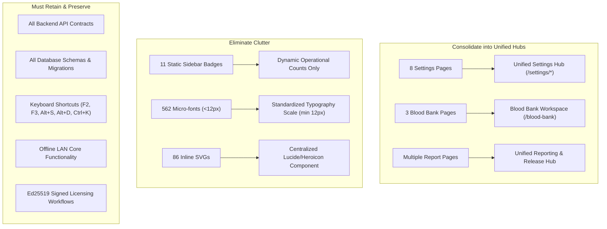

# Aarozi Healthcare LIS — Brad Frost Interface Inventory & Baseline UX Audit
**Document ID:** `docs/ux/00-inventory.md`  
**Phase:** Phase 0 (Baseline Inventory & Audit)  
**Target Environment:** Offline-first Windows Desktop / LAN Local Server (`1366×768` primary viewport, `1920×1080` secondary, `390×844` mobile)  
**Audit Date:** November 2026  
**Auditor:** Senior Product Designer & Lead Front-End Engineer  

---

## Executive Summary

A comprehensive automated and manual Brad Frost interface inventory was conducted across the entire front-end codebase (`apps/web/`, 42 Vue files, 28 routes). 

### Key Critical Findings
1. **Layout Leak on Marketing Page (`/`):** The public commercial landing page (`/`) lacks a layout declaration. Consequently, Nuxt renders the full clinical application shell (`Sidebar`, `TopHeader`, and footer) around the commercial landing page.
2. **Component Adoption Disconnect:** Despite the presence of atomic primitives in `components/ui/` (`Button.vue`, `Input.vue`, `DataTable.vue`), **0% of pages utilize them**. 100% of pages (336 buttons, 180 inputs, 57 dropdowns, 32 tables) bypass design system components and implement bespoke raw HTML with inconsistent inline styles and ad-hoc Tailwind utility strings.
3. **Typography & Readability Hazards on Low-End Displays:** 562 distinct instances of micro-fonts (`< 12px`, including `text-[8px]`, `text-[9px]`, `text-[10px]`, `text-[11px]`) are scattered across clinical pages. On standard 1366×768 18.5" lab monitors (common across Indian pathology centers), these text strings are virtually illegible without squinting.
4. **Information Architecture Clutter:** The navigation sidebar currently lists **22 items across 5 accordion groups** with 11 static marketing badges (`New UHID`, `1000+`, `ASTM/HL7`, `Ed25519`, `POS`) and duplicate iconography (`document-report` used for 4 distinct pages, `beaker` used twice).
5. **Lack of Route Guards & Session Protection:** Authentication tokens and user station metadata are persisted in `localStorage`, but no client-side Nuxt router middleware exists to guard protected clinical pages (`/dashboard`, `/patients/register`, `/pathology/results`, etc.).
6. **Font Dependency:** Nuxt's CSS references `Inter`, but no local `@font-face` WOFF2 fonts are bundled in `public/fonts/`. Machines without system-installed Inter fall back to generic OS system fonts (`Segoe UI` or `sans-serif`).

---

## 1. Route Map & Jobs-To-Be-Done (JTBD)

| Route | Source File | Current Layout | Primary User Role | Core Job-To-Be-Done (JTBD) |
| :--- | :--- | :--- | :--- | :--- |
| `/` | [`pages/index.vue`](file:///c:/Users/techn/Documents/Aarozi_Healthcare/apps/web/pages/index.vue) | `default` *(LEAK)* | Lab Owner / Buyer | Evaluate Aarozi features, select Yearly or Lifetime license plan, request demo or purchase online. |
| `/login` | [`pages/login.vue`](file:///c:/Users/techn/Documents/Aarozi_Healthcare/apps/web/pages/login.vue) | `false` (Custom) | All Staff (6 Roles) | Securely authenticate staff credentials, select assigned workstation bench and operating laboratory branch. |
| `/dashboard` | [`pages/dashboard.vue`](file:///c:/Users/techn/Documents/Aarozi_Healthcare/apps/web/pages/dashboard.vue) | `default` | Lab Owner / Admin | High-level clinical and financial pulse: daily sample volume, revenue, pending turnaround time, panic alerts. |
| `/patients` | [`pages/patients/index.vue`](file:///c:/Users/techn/Documents/Aarozi_Healthcare/apps/web/pages/patients/index.vue) | `default` | Receptionist | Rapid patient directory lookup by UHID, phone number, or name; retrieve visit and report history. |
| `/patients/register` | [`pages/patients/register.vue`](file:///c:/Users/techn/Documents/Aarozi_Healthcare/apps/web/pages/patients/register.vue) | `default` | Receptionist | Register new/walk-in patient in < 60s, select investigations, collect cash/UPI payment, print invoice & barcodes. |
| `/pathology/results` | [`pages/pathology/results.vue`](file:///c:/Users/techn/Documents/Aarozi_Healthcare/apps/web/pages/pathology/results.vue) | `default` | Lab Technician | Worklist queue management, rapid keyboard analyte entry, auto-flagging critical panic and abnormal values. |
| `/pathology/samples` | [`pages/pathology/samples.vue`](file:///c:/Users/techn/Documents/Aarozi_Healthcare/apps/web/pages/pathology/samples.vue) | `default` | Phlebotomist / Accessioner | Accession collected vials, verify barcode scans, update sample status (collected, received, rejected with reason). |
| `/pathology/verification`| [`pages/pathology/verification.vue`](file:///c:/Users/techn/Documents/Aarozi_Healthcare/apps/web/pages/pathology/verification.vue) | `default` | Pathologist | Verification queue sorted by panic severity, clinical result validation, one-click digital approval and signing. |
| `/pathology/catalog` | [`pages/pathology/catalog.vue`](file:///c:/Users/techn/Documents/Aarozi_Healthcare/apps/web/pages/pathology/catalog.vue) | `default` | Lab Admin | Manage 1000+ test definitions, parameters, specimen types, normal ranges by age/gender, and pricing. |
| `/pathology/instruments`| [`pages/pathology/instruments.vue`](file:///c:/Users/techn/Documents/Aarozi_Healthcare/apps/web/pages/pathology/instruments.vue) | `default` | Tech / IT Admin | Monitor bidirectional ASTM / HL7 serial/TCP instrument interfaces and raw packet diagnostics. |
| `/pathology/index` | [`pages/pathology/index.vue`](file:///c:/Users/techn/Documents/Aarozi_Healthcare/apps/web/pages/pathology/index.vue) | `default` | Lab Tech | Pathology overview dashboard (redundant with `/pathology/results`). |
| `/reporting/release` | [`pages/reporting/release.vue`](file:///c:/Users/techn/Documents/Aarozi_Healthcare/apps/web/pages/reporting/release.vue) | `default` | Dispatch Clerk | Deliver verified reports via WhatsApp Cloud API or thermal/A4 PDF print with verification QR codes. |
| `/reporting/designer` | [`pages/reporting/designer.vue`](file:///c:/Users/techn/Documents/Aarozi_Healthcare/apps/web/pages/reporting/designer.vue) | `default` | Lab Admin | Visual report layout customizer: letterhead margins, logo positioning, doctor signature blocks. |
| `/reporting/templates`| [`pages/reporting/templates.vue`](file:///c:/Users/techn/Documents/Aarozi_Healthcare/apps/web/pages/reporting/templates.vue) | `default` | Lab Admin | Select and preview standardized NABL-compliant report templates. |
| `/reporting/index` | [`pages/reporting/index.vue`](file:///c:/Users/techn/Documents/Aarozi_Healthcare/apps/web/pages/reporting/index.vue) | `default` | Dispatch Clerk | Report repository log (partially overlapping with `/reporting/release`). |
| `/billing/invoices` | [`pages/billing/invoices.vue`](file:///c:/Users/techn/Documents/Aarozi_Healthcare/apps/web/pages/billing/invoices.vue) | `default` | Receptionist / Cashier | POS billing ledger, pending balances, invoice re-printing, refund processing, split payment recording. |
| `/billing/referrals` | [`pages/billing/referrals.vue`](file:///c:/Users/techn/Documents/Aarozi_Healthcare/apps/web/pages/billing/referrals.vue) | `default` | Lab Owner / Accountant | Track referral doctors and collection centers, calculate monthly commission incentives, export ledgers. |
| `/blood_bank/donors` | [`pages/blood_bank/donors.vue`](file:///c:/Users/techn/Documents/Aarozi_Healthcare/apps/web/pages/blood_bank/donors.vue) | `default` | Blood Bank Staff | Donor registration, deferral screening, donation records, TTIs testing documentation. |
| `/blood_bank/inventory`| [`pages/blood_bank/inventory.vue`](file:///c:/Users/techn/Documents/Aarozi_Healthcare/apps/web/pages/blood_bank/inventory.vue) | `default` | Blood Bank Tech | Component inventory (PRBC, FFP, Platelets), ABO/Rh groups, expiry monitoring, cold chain storage bins. |
| `/blood_bank/crossmatch`| [`pages/blood_bank/crossmatch.vue`](file:///c:/Users/techn/Documents/Aarozi_Healthcare/apps/web/pages/blood_bank/crossmatch.vue) | `default` | Blood Bank Pathologist | Serological cross-match verification, unit reservation, issue authorization for patient transfusion. |
| `/admin/commercial` | [`pages/admin/commercial.vue`](file:///c:/Users/techn/Documents/Aarozi_Healthcare/apps/web/pages/admin/commercial.vue) | `default` | Superadmin / Vendor | Commercial plan pricing administration, GST slabs, promo codes, and discount governance. |
| `/admin/licensing` | [`pages/admin/licensing.vue`](file:///c:/Users/techn/Documents/Aarozi_Healthcare/apps/web/pages/admin/licensing.vue) | `default` | Lab Owner / Admin | Offline Ed25519 license inspection, hardware machine fingerprint generator, offline activation file upload. |
| `/admin/users` | [`pages/admin/users.vue`](file:///c:/Users/techn/Documents/Aarozi_Healthcare/apps/web/pages/admin/users.vue) | `default` | Lab Admin | Staff user directory, credential reset, branch assignment, security role attachment. |
| `/admin/roles` | [`pages/admin/roles.vue`](file:///c:/Users/techn/Documents/Aarozi_Healthcare/apps/web/pages/admin/roles.vue) | `default` | Lab Admin | Fine-grained RBAC permission matrix configuration. |
| `/admin/integrations` | [`pages/admin/integrations.vue`](file:///c:/Users/techn/Documents/Aarozi_Healthcare/apps/web/pages/admin/integrations.vue) | `default` | Lab Admin | External service settings: WhatsApp Cloud API keys, SMS gateway configurations, analyzer webhooks. |
| `/admin/sync` | [`pages/admin/sync.vue`](file:///c:/Users/techn/Documents/Aarozi_Healthcare/apps/web/pages/admin/sync.vue) | `default` | Lab Admin | LAN SQLite health, local backup schedule, Google Drive customer-owned cloud synchronization. |
| `/admin/migration` | [`pages/admin/migration.vue`](file:///c:/Users/techn/Documents/Aarozi_Healthcare/apps/web/pages/admin/migration.vue) | `default` | Lab Admin | Data import wizard from legacy LIS systems via CSV/Excel formats. |
| `/customer/dashboard` | [`pages/customer/dashboard.vue`](file:///c:/Users/techn/Documents/Aarozi_Healthcare/apps/web/pages/customer/dashboard.vue) | `default` | Customer (Buyer) | Customer SaaS portal: download Windows standalone installer, view purchase invoices, request activation keys. |

---

## 2. Brad Frost Interface Inventory: Quantitative Metrics

Empirical analysis across all 42 `.vue` files in `apps/web/`:

```
================================================================================
AAROZI HEALTHCARE — BRAD FROST INTERFACE INVENTORY
================================================================================
Vue Files Scanned:                 42 files
Total Raw Buttons:                336 instances
Design System Button Components:    0 instances (0% adoption)
Total Raw Inputs:                 180 instances
Design System Input Components:     0 instances (0% adoption)
Total Raw Select Dropdowns:        57 instances
Design System Select Components:    0 instances (0% adoption)
Total Raw Tables:                  32 instances
Design System DataTable Components: 0 instances (0% adoption)
Total Raw Modals (inline divs):    32 instances
Design System Modal Components:     9 instances (22% adoption)
Distinct Inline SVG Icons:         86 unique paths
Distinct Spacing / Margin Values:  55 classes
Distinct Background Color Classes: 58 classes
Distinct Text Color Classes:       73 classes
Distinct Border Color Classes:     52 classes
Arbitrary Hex Colors in Brackets:   9 bracketed hex values
Arbitrary Pixel Values in Brackets:12 bracketed px values
Distinct Text Sizes:               13 sizes (562 occurrences < 12px)
Loading Spinners:                  19 instances
Loading Skeletons:                 18 instances
Empty States Handled:              19 instances
================================================================================
```

### 2.1 Buttons Breakdown
- **Existing Custom Button Utility Classes:**
  - `.btn-primary` (`#0d9488` teal): 13 occurrences
  - `.btn-secondary` (`#ffffff` slate border): 21 occurrences
  - `.btn-emerald` (`#059669` green): 8 occurrences
  - `.btn-ghost` (transparent text-slate): 2 occurrences
  - `.btn-danger` (`#fef2f2` red): 1 occurrence
  - **Inline Raw Button Class Strings:** ~291 occurrences! Pages frequently use ad-hoc combinations like:
    `class="px-3 py-1.5 bg-blue-600 hover:bg-blue-700 text-white rounded text-xs font-semibold"` or
    `class="px-4 py-2 bg-slate-900 text-white rounded-lg hover:bg-slate-800 text-sm"` or
    `class="p-1 text-slate-400 hover:text-slate-600 hover:bg-slate-100 rounded"`.
- **States:**
  - Disabled states: Inconsistently applied (some use `:disabled="loading"` with `opacity-50`, others have no disabled state and allow double-clicks).
  - Hover states: Mixed between `hover:bg-slate-50`, `hover:bg-slate-100`, `hover:bg-sky-700`, `hover:bg-blue-700`.
  - Focus rings: Mostly missing or inconsistent (`focus:ring-2 focus:ring-blue-600` vs `focus:ring-teal-500` vs none).

### 2.2 Typography Breakdown & Micro-Font Audit
The app suffers from severe font size fragmentation. Most alarmingly, **562 text elements are smaller than the standard 12px accessibility baseline**:

| Font Class | Font Size (px) | Occurrences | Risk / Evaluation |
| :--- | :--- | :--- | :--- |
| `text-[8px]` | 8px | 17 | **Severe Hazard**: Unreadable on 1366×768 monitors; used for table sub-captions and badge tags. |
| `text-[9px]` | 9px | 34 | **Severe Hazard**: Illegible without extreme eye strain; used for timestamps and status chips. |
| `text-[10px]` | 10px | 225 | **High Risk**: Found in almost every table header, badge, and secondary metadata line. |
| `text-[11px]` | 11px | 286 | **High Risk**: Used for form labels, breadcrumbs, card subtitles, and table cells. |
| `text-xs` | 12px | 594 | Dominant body size across the entire application. |
| `text-sm` | 14px | 119 | Used for card titles and section headers. |
| `text-base` | 16px | 42 | Used for top-level page headers and main totals. |
| `text-lg` | 18px | 50 | Card titles and KPI stat numbers. |
| `text-xl` | 20px | 32 | Modal headers and primary metric summaries. |
| `text-2xl` | 24px | 18 | Prominent KPI figures and login title. |
| `text-3xl` | 30px | 2 | Hero section subtitles. |
| `text-4xl` | 36px | 4 | Marketing hero title. |
| `text-6xl` | 60px | 1 | Marketing headline accent. |

### 2.3 Color Palette & Bracketed Hex Violations
- **Arbitrary Bracketed Hex Values Found:**
  - `bg-[#0c1322]` (Used on Login dark background)
  - `bg-[#0c3b5e]` (Dark blue brand accent)
  - `bg-[#0f2942]` (Dark slate-blue header)
  - `bg-[#1e293b]` (Slate-800 equivalent)
  - `bg-[#f4f7fb]` (Layout background grey-blue)
  - `bg-[#f8fafc]` (HTML base background)
  - `text-[#047857]` (Emerald-700 equivalent)
  - `text-[#059669]` (Emerald-600 equivalent)
  - `text-[#eab308]` (Yellow-500 equivalent)
- **Arbitrary Bracketed Pixel Spacings Found:**
  - `[2px]`, `[8px]`, `[9px]`, `[10px]`, `[11px]`, `[100px]`, `[240px]`, `[260px]`, `[280px]`, `[360px]`, `[500px]`, `[900px]`.
- **Color Families Clashing:**
  - The UI simultaneously uses **Teal** (`#0d9488`), **Emerald** (`#059669`), **Sky** (`#0284c7`), **Blue** (`#2563eb`), and **Indigo** (`#4f46e5`) as competing "primary action" colors across different screens.

### 2.4 Tables & Worklists
- **Total Tables:** 32 raw HTML `<table>` elements.
- **Inconsistencies:**
  - Header padding ranges from `py-1 text-[10px]` to `py-3 text-xs`.
  - Row density varies widely: some rows have `h-8` compact density, others `h-14` loose density.
  - Alternating zebra striping is present on 4 tables and missing on 28.
  - Pagination controls vary: some pages have no pagination (unbounded lists), some have custom inline buttons, and only 2 use `PaginationBar.vue`.

### 2.5 Badges & Status Pills
- **Count:** Over 120 status pill instances across tables and headers.
- **Inconsistencies:**
  - `Pending`: rendered as `bg-amber-100 text-amber-700`, `bg-yellow-50 text-yellow-600`, or `bg-slate-100 text-slate-600`.
  - `Completed`: rendered as `bg-emerald-100 text-emerald-700`, `bg-green-100 text-green-700`, or `bg-teal-50 text-teal-700`.
  - `Critical Panic`: rendered as `bg-red-100 text-red-700 animate-pulse` or `bg-red-500 text-white font-bold`.

### 2.6 Modal Dialogs & Drawers
- **Count:** 41 modal overlays (32 raw fixed divs with `z-50`, 9 instances using `components/ui/Modal.vue`).
- **Issues:**
  - Backdrop styles conflict (`bg-slate-900/50 backdrop-blur-xs` vs `bg-black/60` vs `bg-slate-900/80`).
  - Close button behavior varies: some support Escape key and backdrop click, others trap focus or have no close icon.

### 2.7 Loading & Empty States
- **Loading:** 19 inline spinners (`animate-spin`), 18 skeleton pulse bars (`animate-pulse`). Most data-loading routines render raw text `"Loading..."` instead of structured skeleton rows.
- **Empty States:** 19 text matches for empty records, but none use an engaging illustration or clear call-to-action button (e.g. "No patients found - Register Patient [F2]").

### 2.8 Iconography
- **86 distinct inline SVG paths** pasted directly into Vue templates.
- **Icon duplication:**
  - `document-report` SVG path is reused for 4 completely different concepts (Worklist, Reports, Visual Designer, Theme Gallery).
  - `beaker` SVG path is reused for both Samples and Hardware Analyzers.
  - `archive` is reused for Blood Bags and Test Catalog.
  - Sizing is inconsistent: `w-3 h-3`, `w-3.5 h-3.5`, `w-4 h-4`, `w-5 h-5`, `w-6 h-6`, and `w-8 h-8` used without systematic token alignment.

---

## 3. Baseline Screenshot Gallery (Before Redesign)

All 36 baseline screenshots were captured at both **1366×768 (Desktop Primary)** and **390×844 (Mobile)** via automated headless browser rendering:

| Route Slug | Route URL | Desktop Baseline (1366×768) | Mobile Baseline (390×844) |
| :--- | :--- | :--- | :--- |
| `landing` | `/` | [landing-1366x768.png](file:///c:/Users/techn/Documents/Aarozi_Healthcare/docs/ux/before/landing-1366x768.png) | [landing-390x844.png](file:///c:/Users/techn/Documents/Aarozi_Healthcare/docs/ux/before/landing-390x844.png) |
| `login` | `/login` | [login-1366x768.png](file:///c:/Users/techn/Documents/Aarozi_Healthcare/docs/ux/before/login-1366x768.png) | [login-390x844.png](file:///c:/Users/techn/Documents/Aarozi_Healthcare/docs/ux/before/login-390x844.png) |
| `dashboard` | `/dashboard` | [dashboard-1366x768.png](file:///c:/Users/techn/Documents/Aarozi_Healthcare/docs/ux/before/dashboard-1366x768.png) | [dashboard-390x844.png](file:///c:/Users/techn/Documents/Aarozi_Healthcare/docs/ux/before/dashboard-390x844.png) |
| `registration`| `/patients/register` | [registration-1366x768.png](file:///c:/Users/techn/Documents/Aarozi_Healthcare/docs/ux/before/registration-1366x768.png) | [registration-390x844.png](file:///c:/Users/techn/Documents/Aarozi_Healthcare/docs/ux/before/registration-390x844.png) |
| `patients` | `/patients` | [patients-1366x768.png](file:///c:/Users/techn/Documents/Aarozi_Healthcare/docs/ux/before/patients-1366x768.png) | [patients-390x844.png](file:///c:/Users/techn/Documents/Aarozi_Healthcare/docs/ux/before/patients-390x844.png) |
| `worklist` | `/pathology/results` | [worklist-1366x768.png](file:///c:/Users/techn/Documents/Aarozi_Healthcare/docs/ux/before/worklist-1366x768.png) | [worklist-390x844.png](file:///c:/Users/techn/Documents/Aarozi_Healthcare/docs/ux/before/worklist-390x844.png) |
| `samples` | `/pathology/samples` | [samples-1366x768.png](file:///c:/Users/techn/Documents/Aarozi_Healthcare/docs/ux/before/samples-1366x768.png) | [samples-390x844.png](file:///c:/Users/techn/Documents/Aarozi_Healthcare/docs/ux/before/samples-390x844.png) |
| `verification`| `/pathology/verification` | [verification-1366x768.png](file:///c:/Users/techn/Documents/Aarozi_Healthcare/docs/ux/before/verification-1366x768.png) | [verification-390x844.png](file:///c:/Users/techn/Documents/Aarozi_Healthcare/docs/ux/before/verification-390x844.png) |
| `reports` | `/reporting/release` | [reports-1366x768.png](file:///c:/Users/techn/Documents/Aarozi_Healthcare/docs/ux/before/reports-1366x768.png) | [reports-390x844.png](file:///c:/Users/techn/Documents/Aarozi_Healthcare/docs/ux/before/reports-390x844.png) |
| `invoices` | `/billing/invoices` | [invoices-1366x768.png](file:///c:/Users/techn/Documents/Aarozi_Healthcare/docs/ux/before/invoices-1366x768.png) | [invoices-390x844.png](file:///c:/Users/techn/Documents/Aarozi_Healthcare/docs/ux/before/invoices-390x844.png) |
| `referrals` | `/billing/referrals` | [referrals-1366x768.png](file:///c:/Users/techn/Documents/Aarozi_Healthcare/docs/ux/before/referrals-1366x768.png) | [referrals-390x844.png](file:///c:/Users/techn/Documents/Aarozi_Healthcare/docs/ux/before/referrals-390x844.png) |
| `catalog` | `/pathology/catalog` | [catalog-1366x768.png](file:///c:/Users/techn/Documents/Aarozi_Healthcare/docs/ux/before/catalog-1366x768.png) | [catalog-390x844.png](file:///c:/Users/techn/Documents/Aarozi_Healthcare/docs/ux/before/catalog-390x844.png) |
| `instruments` | `/pathology/instruments` | [instruments-1366x768.png](file:///c:/Users/techn/Documents/Aarozi_Healthcare/docs/ux/before/instruments-1366x768.png) | [instruments-390x844.png](file:///c:/Users/techn/Documents/Aarozi_Healthcare/docs/ux/before/instruments-390x844.png) |
| `designer` | `/reporting/designer` | [designer-1366x768.png](file:///c:/Users/techn/Documents/Aarozi_Healthcare/docs/ux/before/designer-1366x768.png) | [designer-390x844.png](file:///c:/Users/techn/Documents/Aarozi_Healthcare/docs/ux/before/designer-390x844.png) |
| `templates` | `/reporting/templates` | [templates-1366x768.png](file:///c:/Users/techn/Documents/Aarozi_Healthcare/docs/ux/before/templates-1366x768.png) | [templates-390x844.png](file:///c:/Users/techn/Documents/Aarozi_Healthcare/docs/ux/before/templates-390x844.png) |
| `blood_inventory` | `/blood_bank/inventory` | [blood_inventory-1366x768.png](file:///c:/Users/techn/Documents/Aarozi_Healthcare/docs/ux/before/blood_inventory-1366x768.png) | [blood_inventory-390x844.png](file:///c:/Users/techn/Documents/Aarozi_Healthcare/docs/ux/before/blood_inventory-390x844.png) |
| `licensing` | `/admin/licensing` | [licensing-1366x768.png](file:///c:/Users/techn/Documents/Aarozi_Healthcare/docs/ux/before/licensing-1366x768.png) | [licensing-390x844.png](file:///c:/Users/techn/Documents/Aarozi_Healthcare/docs/ux/before/licensing-390x844.png) |
| `commercial` | `/admin/commercial` | [commercial-1366x768.png](file:///c:/Users/techn/Documents/Aarozi_Healthcare/docs/ux/before/commercial-1366x768.png) | [commercial-390x844.png](file:///c:/Users/techn/Documents/Aarozi_Healthcare/docs/ux/before/commercial-390x844.png) |

---

## 4. Auth Stack & Session Findings

- **Authentication Mechanism:**
  - Custom JWT Bearer token system integrated in [`apps/web/composables/useApi.ts`](file:///c:/Users/techn/Documents/Aarozi_Healthcare/apps/web/composables/useApi.ts).
  - In browser contexts, `useApi` extracts `token` or `access_token` from `localStorage` and appends `Authorization: Bearer <token>` to all HTTP requests.
- **Login Flow (`/login`):**
  - Sends `POST /auth/login` with `{ username, password }`.
  - On network failure or offline desktop operation, falls back to a simulated offline demo token (`offline_demo_token_authenticated`).
  - Sets `aarozi_user` object in `localStorage` storing `{ username, station, branch }`.
- **Gaps & Vulnerabilities:**
  - **No Global Auth Guard Middleware:** Routes under `/dashboard`, `/patients/*`, `/pathology/*`, and `/admin/*` do not check for valid tokens before rendering. Any visitor can navigate directly to internal clinical screens.
  - **No Role-Based Authorization Guard:** Staff logged in under a "Phlebotomist" station are not restricted from accessing financial referral ledgers or administrative licensing pages.
  - **Branch State Persistence:** Selected branch is stored in memory via `ref()` inside `useBranch.ts` without automatic synchronization to `localStorage`, resetting to default upon page refresh.

---

## 5. CSS Architecture & Styling Approach

- **Framework:** Tailwind CSS v4 using `@tailwindcss/vite` plugin with Nuxt 3.
- **Configuration:** No standalone `tailwind.config.js`; styling relies on `@import "tailwindcss";` in [`assets/css/main.css`](file:///c:/Users/techn/Documents/Aarozi_Healthcare/apps/web/assets/css/main.css).
- **Custom Classes:** 
  - Standard button and form utilities were added to `main.css` (`btn-primary`, `btn-secondary`, `btn-emerald`, `btn-danger`, `btn-ghost`, `select-faang`, `filter-pill`, `input-faang`).
  - However, because these classes were never encapsulated into reactive Vue components, individual pages mix utility classes with arbitrary Tailwind brackets (`bg-[#0c1322]`, `text-[10px]`, `w-[280px]`).
- **Font & Offline Bundling:**
  - `main.css` declares `font-family: Inter, -apple-system, BlinkMacSystemFont, "Segoe UI", Roboto, sans-serif;`.
  - No `@font-face` rules or local `.woff2` files are present in `public/`.
  - When disconnected from the internet, client machines rely entirely on system font fallbacks (`Segoe UI` on Windows), resulting in inconsistent typographic metrics and vertical alignment shifts.

---

## 6. Layout & Shell Architecture Audit

### 6.1 Layout Leak
- Nuxt automatically wraps all pages in `layouts/default.vue` unless explicitly overridden via `definePageMeta({ layout: false })`.
- Only `pages/login.vue` has `layout: false`.
- The public landing page (`pages/index.vue`) does NOT declare a layout, resulting in the commercial homepage rendering inside the clinical sidebar, header, and footer.

### 6.2 Sidebar Clutter (22 Items, 5 Groups)
- Current sidebar contains **22 navigation items**:
  - `frontDesk`: 2 items (Patient Directory, Intake & Registration)
  - `labOps`: 4 items (Worklist, Sample Tracking, Verification, Report Release)
  - `finance`: 2 items (Invoices, Referral Doctors)
  - `specialty`: 3 items (Donor Registry, Blood Inventory, Cross-Match)
  - `settings`: 8 items (Catalog, Instruments, Visual Designer, Theme Gallery, Integrations, Sync, Licensing, Staff)
- **11 Decorative Badges:** Non-functional badges (`New UHID`, `Results`, `Sign-off`, `QR PDF`, `POS`, `1000+`, `ASTM/HL7`, `Studio`, `WhatsApp`, `Hybrid`, `Ed25519`) take up horizontal width, forcing menu text to truncate on 1366×768 resolution.
- **Duplicate Icons:**
  - `document-report` icon is used 4 times.
  - `beaker` icon is used 2 times.
  - `archive` icon is used 2 times.
  - `heart` icon is used 2 times.
  - `users` icon is used 2 times.

### 6.3 TopHeader Redundancy
- Left side displays `NABL Accredited LIS • Main City Branch (HQ)`.
- Right side displays a branch dropdown selector that repeats the same branch name.
- Static "NABL Accredited LIS" badge does not reflect real tenant accreditation status.

---

## 7. Retain, Delete, and Consolidate Roadmap



### 7.1 What We MUST KEEP (Preserve Intact)
1. **All API endpoints and backend contracts:** No changes to FastAPI routes, schemas, or models.
2. **Offline-first LAN operation:** No cloud dependencies for local registration, testing, billing, or reporting.
3. **Keyboard shortcuts:**
   - `F2`: Quick Register Patient
   - `F3`: Quick Barcode Search
   - `Ctrl+K`: Global Command Palette
   - `Alt+S`: Save / Submit
   - `Alt+D`: Dispatch / Print
4. **Existing routes & bookmark compatibility:** All existing paths will remain functional (via redirects if nested).
5. **Ed25519 license validation** and offline machine fingerprinting logic.

### 7.2 What We CAN DELETE / REMOVE
1. **11 static decorative badges** from the sidebar that waste horizontal viewport space.
2. **Duplicate branch indicator** on TopHeader (keep only the interactive selector).
3. **Unverified "NABL Accredited" static marketing pill** from the operational top header.
4. **Micro-font definitions** (`text-[8px]`, `text-[9px]`, `text-[10px]`, `text-[11px]`) in body content and tables.
5. **Redundant inline SVG paths** across templates (replace with structured icon library/component).
6. **Hardcoded dev disclaimer footer** (`Complete UI/UX for Modern Indian Pathology Laboratory • 2026`).

### 7.3 What We MUST CONSOLIDATE
1. **Layouts Structure:**
   - `layouts/marketing.vue`: Clean standalone layout for `/` landing page, pricing, and demo requests.
   - `layouts/auth.vue`: Clean centered layout for `/login`.
   - `layouts/app.vue`: Streamlined, high-density LIS workstation shell for authenticated clinical workflows.
2. **Navigation Consolidation:**
   - Reduce top-level sidebar items from 22 to **11 primary clinical workspaces**:
     1. `Dashboard`
     2. `Registration` (Intake + UHID lookup)
     3. `Worklist` (Results entry + Panic triage)
     4. `Samples` (Phlebotomy + Barcodes)
     5. `Verification` (Pathologist approval)
     6. `Reports` (PDF generation + WhatsApp dispatch)
     7. `Billing & Invoices` (POS + Ledger)
     8. `Referrals` (Doctor incentives)
     9. `Blood Bank` (Donors + Inventory + Crossmatch)
     10. `Catalog` (Test master + Pricing)
     11. `Settings Hub` (Instruments, Templates, Users, Licensing, Sync)
3. **Design System & Token Architecture (Phase 1 Target):**
   - Implement **3-Tier Design Tokens** (`assets/css/tokens.css`):
     - Tier 1: Global Primitive Tokens (colors, spacing, font sizes).
     - Tier 2: Semantic Tokens (surface, text-primary, border-subtle, status-danger, status-panic).
     - Tier 3: Component Tokens (`btn-height`, `table-row-compact`, `input-border`).
   - Standardize all 336 buttons, 180 inputs, 57 selects, and 32 tables on unified, keyboard-accessible Vue components in `components/ui/`.
   - Enforce 12px minimum font size (`text-xs` / `0.75rem`) across all operational views.
   - Bundle self-hosted WOFF2 Inter fonts into `public/fonts/` for 100% offline compliance.

---

## 8. Next Step & Checkpoint

Phase 0 is complete with all quantitative metrics verified and 36 baseline screenshots captured.

Per project protocol: **STOPPING AND REPORTING TO USER BEFORE COMMENCING PHASE 1 (DESIGN SYSTEM TOKENS & COMPONENTS).**

