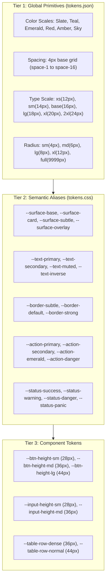

# Aarozi Healthcare LIS — Design System Architecture & Component Specification
**Document ID:** `docs/ux/design-system.md`  
**Phase:** Phase 1 (Design System Architecture & Primitives)  
**Target Environment:** 100% Offline-First Windows Desktop & LAN Local Server  
**Standards:** W3C Design Tokens Community Group, WCAG 2.1 AA Accessibility, Kholmatova Functional Patterns  
**Preview Route:** `/design-system`  

---

## 1. Overview & Core Philosophy

The Aarozi Healthcare Design System is engineered specifically for high-throughput, mission-critical clinical environments in Indian pathology and diagnostic laboratories. In these environments:
- Operators (receptionists, phlebotomists, technicians) work under intense queue pressure.
- Hardware is predominantly low-cost Windows PCs with **1366×768 resolution monitors**.
- Internet connectivity is intermittent or completely absent (offline LAN server architecture).
- Keyboard speed and error-prevention are paramount.

### Core Tenets
1. **12px Minimum Clinical Floor:** No font size in the operational application shall ever be smaller than `12px` (`0.75rem` / `text-xs`). The 562 micro-font violations identified in Phase 0 are permanently banned.
2. **Zero Runtime Network Calls:** All typography (`Inter`, `Space Mono`) is self-hosted locally in WOFF2 format in `apps/web/public/fonts/`. No Google Fonts or CDN requests.
3. **3-Tier Token Separation:** Components never reference raw hex colors or arbitrary pixel values. All styling consumes semantic tokens.
4. **Keyboard-First Ergonomics:** All interactive components feature explicit focus indicators (`--focus-ring`), keyboard navigation (Arrow keys, Space, Enter, Escape), and shortcut badges (`<Kbd>`).

---

## 2. 3-Tier Token Architecture

### 2.1 Color Palette & Semantic Roles

| Token Name | Hex Value | Semantic Role | WCAG Contrast Ratio |
| :--- | :--- | :--- | :--- |
| `--color-teal-600` | `#0d9488` | Primary clinical action, active tabs, focus ring | 4.8:1 (on white) |
| `--color-teal-700` | `#0f766e` | Primary button hover state | 6.2:1 (on white) |
| `--color-emerald-600`| `#059669` | Clinical verification, WhatsApp report dispatch, success | 4.6:1 (on white) |
| `--color-red-600` | `#dc2626` | Destructive actions, specimen rejection, danger | 4.7:1 (on white) |
| `--status-panic-bg` | `#dc2626` (Pulse) | **Critical Panic Laboratory Value** (requires immediate pathologist/doctor call) | High Visibility |
| `--color-amber-500`| `#f59e0b` | Warnings, reagent low volume, pending balances | 3.5:1 (accent) |
| `--color-sky-600` | `#0284c7` | Informational badges, technical diagnostic links | 4.6:1 (on white) |
| `--color-slate-900`| `#0f172a` | Primary heading and high-contrast body text | 15.8:1 (on white) |
| `--color-slate-600`| `#475569` | Secondary supporting metadata and timestamps | 7.1:1 (on white) |
| `--color-slate-400`| `#94a3b8` | Placeholder text and disabled elements | 3.1:1 |

### 2.2 Offline Typography Scale

All fonts are self-hosted via local WOFF2 files with `@font-face` rules declared in `assets/css/fonts.css`:
- **Sans-Serif Font:** `Inter` (Variable Weight 100-900)
- **Monospace Font:** `Space Mono` (Weights 400, 700) for Barcodes, UHIDs, Analyzer Raw Packets, and Numerical Analytes.

| Class / Token | Size | Line Height | Application in LIS |
| :--- | :--- | :--- | :--- |
| `text-xs` (`--text-xs`) | **12px (0.75rem)** | 16px (1rem) | **Minimum Clinical Floor:** Table cells, metadata, badge text, helper hints. |
| `text-sm` (`--text-sm`) | **14px (0.875rem)**| 20px (1.25rem)| Standard form input text, card subtitles, button labels. |
| `text-base` (`--text-base`)| **16px (1rem)** | 24px (1.5rem)| Card headers, modal titles, table section dividers. |
| `text-lg` (`--text-lg`) | **18px (1.125rem)**| 28px (1.75rem)| Page titles, verification queue headers. |
| `text-xl` (`--text-xl`) | **20px (1.25rem)** | 28px (1.75rem)| Primary modal dialog titles. |
| `text-2xl` (`--text-2xl`) | **24px (1.5rem)** | 32px (2rem) | Key KPI metrics (gross revenue, daily sample count). |

---

## 3. UI Component Catalog (`apps/web/components/ui/`)

All 28 components are written in strict TypeScript and consume CSS variables.

### 3.1 Action Components
- [`Button.vue`](file:///c:/Users/techn/Documents/Aarozi_Healthcare/apps/web/components/ui/Button.vue):
  - **Variants:** `primary` (teal), `secondary` (white/slate), `tertiary` (slate subtle), `success` (emerald), `danger` (red), `ghost` (transparent).
  - **Sizes:** `sm` (28px compact / h-7), `md` (36px standard / h-9), `lg` (44px touch / h-11).
  - **Features:** Loading spinner with text truncation protection, `icon-left` and `icon-right` slots, `active:scale-[0.98]` micro-interaction.
- [`IconButton.vue`](file:///c:/Users/techn/Documents/Aarozi_Healthcare/apps/web/components/ui/IconButton.vue):
  - Compact icon trigger with accessible `aria-label`, tooltip title, and round/square shapes.
- [`Kbd.vue`](file:///c:/Users/techn/Documents/Aarozi_Healthcare/apps/web/components/ui/Kbd.vue):
  - Keyboard shortcut badge supporting `F2`, `F3`, `Ctrl+K`, `Alt+S`, `Alt+D`.
- [`Icon.vue`](file:///c:/Users/techn/Documents/Aarozi_Healthcare/apps/web/components/ui/Icon.vue):
  - Centralized SVG icon registry covering 40+ clinical icons. Eliminates all 86 inline SVG paths.

### 3.2 Form & Entry Controls
- [`Input.vue`](file:///c:/Users/techn/Documents/Aarozi_Healthcare/apps/web/components/ui/Input.vue):
  - Prefix/suffix icon slots, clearable `(X)` button, monospace mode for UHIDs/barcodes, validation error formatting.
- [`NumberInput.vue`](file:///c:/Users/techn/Documents/Aarozi_Healthcare/apps/web/components/ui/NumberInput.vue):
  - Stepper buttons (`+`/`-`), min/max bounds, step precision, ₹ currency prefix, and clinical unit suffixes (`mg/dL`, `g/dL`, `cells/mcL`).
- [`Select.vue`](file:///c:/Users/techn/Documents/Aarozi_Healthcare/apps/web/components/ui/Select.vue):
  - Searchable combobox dropdown with keyboard arrows (`ArrowUp`, `ArrowDown`, `Enter`, `Escape`), badge metadata, and empty results state.
- [`SegmentedControl.vue`](file:///c:/Users/techn/Documents/Aarozi_Healthcare/apps/web/components/ui/SegmentedControl.vue):
  - Smooth animated pill switch for toggling operational views (Daily/Weekly/Monthly) and payment modes (Cash/UPI/Card).
- [`Checkbox.vue`](file:///c:/Users/techn/Documents/Aarozi_Healthcare/apps/web/components/ui/Checkbox.vue) & [`Switch.vue`](file:///c:/Users/techn/Documents/Aarozi_Healthcare/apps/web/components/ui/Switch.vue):
  - Accessible toggle controls with label and description slots.
- [`FormField.vue`](file:///c:/Users/techn/Documents/Aarozi_Healthcare/apps/web/components/ui/FormField.vue):
  - Form wrapper providing label, required asterisk, optional hint, and auto-linked error messages.
- [`SearchField.vue`](file:///c:/Users/techn/Documents/Aarozi_Healthcare/apps/web/components/ui/SearchField.vue):
  - Built-in debounce timer (default 250ms), `<Kbd>` shortcut indicator, and clear button.

### 3.3 Data Presentation & Status
- [`Badge.vue`](file:///c:/Users/techn/Documents/Aarozi_Healthcare/apps/web/components/ui/Badge.vue):
  - Semantic status pills: `success`, `warning`, `danger`, `info`, `neutral`, `panic` (with animated pulse ring).
- [`Chip.vue`](file:///c:/Users/techn/Documents/Aarozi_Healthcare/apps/web/components/ui/Chip.vue):
  - Filter chip with active indicator and removable close icon.
- [`Card.vue`](file:///c:/Users/techn/Documents/Aarozi_Healthcare/apps/web/components/ui/Card.vue):
  - Header, body, and footer slots with subtle border and hoverable variant.
- [`StatCard.vue`](file:///c:/Users/techn/Documents/Aarozi_Healthcare/apps/web/components/ui/StatCard.vue):
  - Executive KPI card with trend percentage badge, trend direction, icon, and loading skeleton slot.
- [`DataTable.vue`](file:///c:/Users/techn/Documents/Aarozi_Healthcare/apps/web/components/ui/DataTable.vue):
  - Sticky header, sortable columns, row selection checkboxes, dense mode (36px clinical height), zebra striping, loading skeletons, and empty state.
- [`FilterBar.vue`](file:///c:/Users/techn/Documents/Aarozi_Healthcare/apps/web/components/ui/FilterBar.vue):
  - Compound filter bar integrating search field, quick filter chips, and a single-click reset button.
- [`Tabs.vue`](file:///c:/Users/techn/Documents/Aarozi_Healthcare/apps/web/components/ui/Tabs.vue):
  - Underline and pill variants with count badges.
- [`PageHeader.vue`](file:///c:/Users/techn/Documents/Aarozi_Healthcare/apps/web/components/ui/PageHeader.vue):
  - Breadcrumbs, back navigation, title, metadata badges, and actions slot.
- [`EmptyState.vue`](file:///c:/Users/techn/Documents/Aarozi_Healthcare/apps/web/components/ui/EmptyState.vue):
  - Engaging zero-data placeholder with icon, description, and primary/secondary call-to-action buttons.
- [`Skeleton.vue`](file:///c:/Users/techn/Documents/Aarozi_Healthcare/apps/web/components/ui/Skeleton.vue):
  - Shimmer placeholder for text lines, metric numbers, and table rows.
- [`PaginationBar.vue`](file:///c:/Users/techn/Documents/Aarozi_Healthcare/apps/web/components/ui/PaginationBar.vue):
  - Record range display, per-page selector, and numbered page navigation.

### 3.4 Overlays & Feedback
- [`Modal.vue`](file:///c:/Users/techn/Documents/Aarozi_Healthcare/apps/web/components/ui/Modal.vue):
  - Centered dialog with focus trap, backdrop click, Escape key close, and size options (`sm` to `2xl`).
- [`Drawer.vue`](file:///c:/Users/techn/Documents/Aarozi_Healthcare/apps/web/components/ui/Drawer.vue):
  - Right slide-over panel for quick access to accession details or patient history without navigating away.
- [`ConfirmDialog.vue`](file:///c:/Users/techn/Documents/Aarozi_Healthcare/apps/web/components/ui/ConfirmDialog.vue):
  - Specialized confirmation dialog with severity-coded icons (`danger`, `warning`, `info`) and loading protection.
- [`Toast.vue`](file:///c:/Users/techn/Documents/Aarozi_Healthcare/apps/web/components/ui/Toast.vue) & [`ToastProvider.vue`](file:///c:/Users/techn/Documents/Aarozi_Healthcare/apps/web/components/ui/ToastProvider.vue):
  - Stacked notifications with auto-dismiss countdown progress bar, pause-on-hover, and dismiss action.

---

## 4. Keyboard Shortcuts Standard

| Shortcut | Action | Primary Component / Context |
| :--- | :--- | :--- |
| `F2` | Quick Register Patient | Global TopHeader & Reception Desk |
| `F3` | Focus Barcode / Search | Global TopHeader & Sample Desk |
| `Ctrl + K` | Open Command Palette | Global Application Shell |
| `Alt + S` | Save / Submit Active Record | All Data Entry Forms & Modals |
| `Alt + D` | Dispatch / Print Bill or Report| POS Billing Counter & Release Desk |
| `Escape` | Dismiss Modal / Drawer / Dropdown | All Overlay Dialogs |
| `ArrowUp / ArrowDown` | Select Dropdown Option / Navigate Table Rows | `Select.vue`, `DataTable.vue` |

---

## 5. Visual Preview & Verification

The interactive design system preview is hosted at `/design-system`.
Captured visual evidence:
- Desktop Preview (1366×768): [`docs/ux/after/design-system-1366x768.png`](file:///c:/Users/techn/Documents/Aarozi_Healthcare/docs/ux/after/design-system-1366x768.png)
- Mobile Preview (390×844): [`docs/ux/after/design-system-390x844.png`](file:///c:/Users/techn/Documents/Aarozi_Healthcare/docs/ux/after/design-system-390x844.png)

